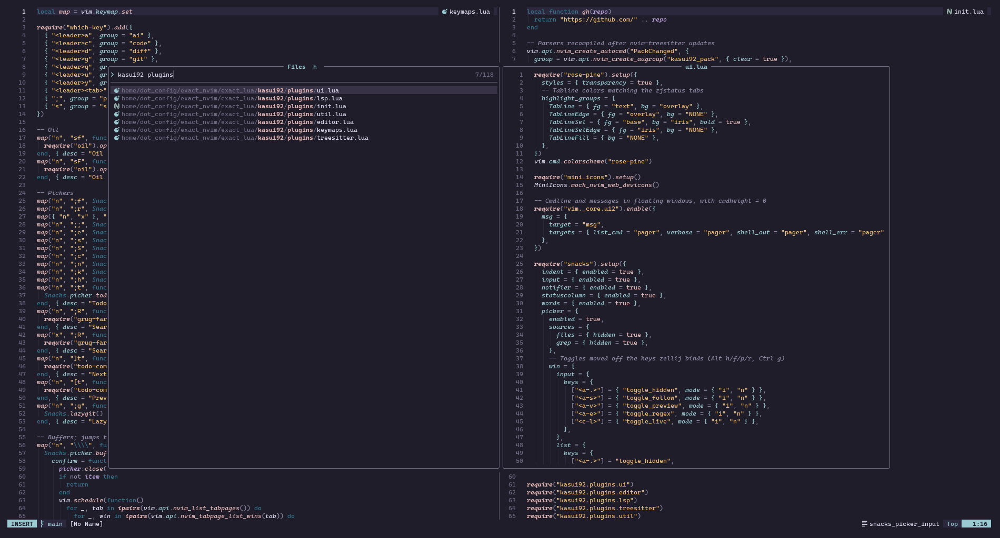

# dotfiles

> What are we, if not the sum of our dotfiles?

My personal dotfiles, managed entirely through [chezmoi](https://www.chezmoi.io).
Everything uses the [Rosé Pine](https://rosepinetheme.com) theme.

## How it works

- `home/` is the chezmoi source; the repo root only holds this README and its images.
- Config for optional tools is applied only where the tool is installed.
- SSH and GPG keys come from Bitwarden, never from the repo.
- Machine-specific files are ignored, see [Machine-local configuration](#machine-local-configuration).
- Also managed: `localsearch-3.service` masked, DMS service environment, three autostart entries disabled.

## Requirements

- chezmoi, git, `jq` (for the `modify_` scripts)
- [mise](https://mise.jdx.dev): installs node, delta and rust on apply
- [Bitwarden CLI](https://bitwarden.com/help/cli/) (`bw`), see [Bitwarden](#bitwarden)
- Neovim >= 0.12, a C compiler, ripgrep and fd; mason installs the language servers, formatters and the tree-sitter CLI on first start
- A Nerd Font (Alacritty uses CaskaydiaMono)
- Optional: niri, DMS, Alacritty, zellij, btop, lazygit, Claude Code; fzf, zoxide, eza and bat for bash

## Machine-local configuration

These files are ignored by chezmoi and optional. Create them only where needed.

| File | Purpose |
| --- | --- |
| `~/.bashrc.local` | Extra shell config, sourced last by `~/.bashrc` |
| `~/.config/git/config-local` | Git settings for this machine, included last by the managed config |
| `~/.gitconfig` | Extra Git settings, read by Git after `~/.config/git/config` |
| `~/.config/niri/config/outputs.kdl` | Monitor layout for niri |
| `~/.config/niri/dms/outputs.kdl` | Monitor layout for niri with DMS |
| `~/.config/niri/dms/cursor.kdl` | Cursor config for niri with DMS |
| `~/.ssh/config.d/*` | SSH hosts, included by the managed `~/.ssh/config` |

### Git

Identities are selected by remote URL: `~/.config/git/config-github`,
`config-gitlab` and `config-codeberg` set the email and enable signing. Git
signs with the GPG key whose user ID matches the commit email, so each email
must have exactly one secret key.

Other identities follow the same pattern from `~/.gitconfig`:

```gitconfig
# ~/.gitconfig
[includeIf "hasconfig:remote.*.url:git@example.com:*/**"]
    path = ~/.config/git/example.identity

# ~/.config/git/example.identity
[user]
    email = user@example.com
[commit]
    gpgsign = true
```

### SSH

The managed `~/.ssh/config` includes `~/.ssh/config.d/*` and sets
`IdentitiesOnly yes`, so every host needs an `IdentityFile` (the private key or
the `.pub` of a key loaded in the agent).

## Bitwarden

SSH and GPG keys come from the Bitwarden vault via `bw`.

| Item | Type | Content |
| --- | --- | --- |
| any name | SSH key | Private key, loaded by `bwu` |
| `gpg-*` | Secure note | Notes: output of `gpg --export-secret-keys --armor <FPR>` |
| same `gpg-*` items | Hidden custom field `passphrase` | Key passphrase, preset into gpg-agent by `bwu` |

`gpg-*` items are the keys for this machine: `bwu` imports the missing ones with
ultimate trust. Keep other GPG keys under a different prefix.

- `bwu`: unlock the vault, load SSH keys, import GPG keys and preset their passphrases, lock the vault again.
- `bwl`: lock the vault, clear the SSH agent and the GPG passphrase cache.
